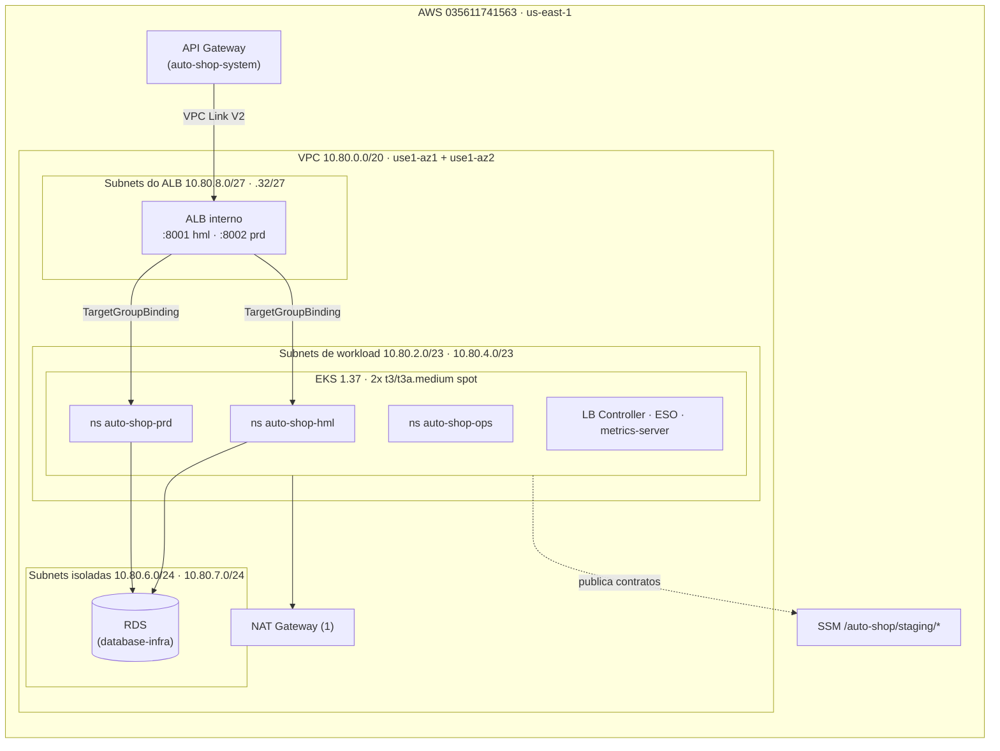

# k8s-infra

Infraestrutura Terraform do cluster Kubernetes (Amazon EKS) do **Auto Shop**, Tech Challenge Fase 3 (FIAP 13SOAT). Este repositório é dono da rede compartilhada, do cluster, do ALB interno e da base de segurança dos namespaces. Decisões: [ADR-0071](https://github.com/Software-Architecture-Group-7-FIAP/auto-shop-system/blob/develop/docs/architecture/decisions/ADR-0071-infraestrutura-cloud-fase-3.md).

| Repositório | Papel |
|---|---|
| [auto-shop-system](https://github.com/Software-Architecture-Group-7-FIAP/auto-shop-system) | Aplicação (FastAPI + Angular), deploy em `auto-shop-hml`/`auto-shop-prd`, API Gateway |
| [lambda-auth](https://github.com/Software-Architecture-Group-7-FIAP/lambda-auth) | Function serverless de autenticação por CPF |
| [database-infra](https://github.com/Software-Architecture-Group-7-FIAP/database-infra) | RDS PostgreSQL e identidades de banco |
| **k8s-infra** (este) | VPC, EKS, node group, ALB interno, add-ons, namespaces, NetworkPolicy |

## Tecnologias

Terraform 1.15 · AWS provider 6.x · `terraform-aws-modules/vpc` 6.7.3 · `terraform-aws-modules/eks` 21.29.0 · Amazon EKS 1.37 · EKS Pod Identity · AWS Load Balancer Controller 3.6.2 · External Secrets Operator 2.14.0 · VPC CNI (NetworkPolicy + prefix delegation) · GitHub Actions com OIDC · `terraform test`, tflint, checkov, shellcheck.

## Arquitetura



## Estrutura

| Caminho | Conteúdo | Ciclo de vida |
|---|---|---|
| `envs/staging/bootstrap` | Provedor OIDC do GitHub, roles `gh-plan-*` e `gh-deploy-*` dos 4 repositórios | Persistente (só IAM, custo zero) |
| `envs/staging/foundation` | VPC, NAT, EKS, node group spot, add-ons EKS, ALB interno, contrato SSM | Efêmero (por sessão) |
| `envs/staging/platform` | LB Controller, ESO, Pod Identity, namespaces, quota, LimitRange, PSS, RBAC, NetworkPolicy | Efêmero (por sessão) |
| `modules/` | `network`, `alb`, `ssm-contract`, com testes `terraform test` | — |
| `scripts/` | `smoke.sh`, `orphans.sh`, `plan-summary.sh` | — |

State: bucket `auto-shop-tfstate-035611741563-use1`, chaves `k8s-infra/staging/<stack>.tfstate`, lock nativo (`use_lockfile`).

## Contrato publicado (SSM, `/auto-shop/staging/...`)

Somente valores não secretos (`String`/`StringList`). Consumidores leem por nome exato; não usam `terraform_remote_state`.

| Parâmetro | Consumidor |
|---|---|
| `network/vpc-id`, `network/vpc-cidr` | database-infra, lambda-auth |
| `network/workload-private-subnet-ids` | lambda-auth |
| `network/rds-isolated-subnet-ids`, `network/rds-isolated-subnet-cidrs` | database-infra |
| `network/alb-subnet-cidrs` | consumido internamente (NetworkPolicy); não é um contrato de outro repositório |
| `network/eks-node-security-group-id`, `network/lambda-security-group-id` | database-infra (regra 5432), lambda-auth |
| `eks/cluster-name`, `eks/cluster-endpoint`, `eks/oidc-provider-arn` | pipelines de deploy |
| `gateway/internal-alb-arn`, `gateway/internal-alb-dns`, `gateway/internal-alb-security-group` | auto-shop-system (VPC Link) |
| `gateway/listener-arn/{hml,prd}`, `gateway/listener-port/{hml,prd}`, `gateway/target-group-arn/{hml,prd}` | auto-shop-system (Gateway e `TargetGroupBinding`) |
| `domain/root`, `domain/api-url`, `domain/frontend-url/{hml,prd}` | auto-shop-system, lambda-auth |

Convenção exigida do `database-infra`: segredo de runtime em `auto-shop/staging/<env>/app-runtime` (o ESO só lê esse padrão).

## Acesso ao cluster

| Identidade | Acesso |
|---|---|
| `gustavo-ferreira` | Cluster admin |
| `gh-deploy-k8s-infra` | Cluster admin |
| `gh-plan-k8s-infra` | Leitura (AdminView) |
| `gh-deploy-auto-shop-system` | Edit em `auto-shop-hml` e `auto-shop-prd` + `TargetGroupBinding`/`ExternalSecret` |
| `gh-deploy-database-infra` | Edit em `auto-shop-ops` (Job de bootstrap de banco) |

## Execução

Pré-requisitos: Terraform 1.15, AWS CLI v2 autenticado na conta `035611741563`, kubectl.

```bash
# Sempre que envs/staging/bootstrap mudar, ANTES do merge — rodar como o usuário IAM admin
# (gustavo-ferreira). As roles de CI não têm permissão para alterar a si mesmas, a boundary, as
# políticas de state/plan-restrictions nem o provedor OIDC (DenyEditingCiIdentities), então um PR
# que mude esse stack nunca se autoaplica; sem isso, a primeira sessão falha ao criar a role do
# cluster/node group com "NoSuchEntity: policy .../auto-shop-boundary does not exist" — depois de já
# ter criado a VPC e o NAT. apply.yml confere a existência da boundary antes de aplicar foundation.
terraform -chdir=envs/staging/bootstrap init && terraform -chdir=envs/staging/bootstrap apply

# Abrir sessão (cobrável)
terraform -chdir=envs/staging/foundation init && terraform -chdir=envs/staging/foundation apply
terraform -chdir=envs/staging/platform init && terraform -chdir=envs/staging/platform apply
./scripts/smoke.sh

# Fechar sessão no mesmo dia
terraform -chdir=envs/staging/platform destroy
terraform -chdir=envs/staging/foundation destroy
./scripts/orphans.sh
```

## CI/CD

| Workflow | Gatilho | O que faz |
|---|---|---|
| `ci.yml` | PR para `main`, diário às 07:17 UTC, manual | Em PR/manual: fmt, validate, `terraform test`, tflint, checkov, shellcheck e plan; diário: valida que o Environment `staging` permite somente `main` |
| `apply.yml` | merge em `main` com `STAGING_ACTIVE=true`, ou manual | apply foundation → platform + smoke test |
| `destroy.yml` | manual (confirmar `destroy`) e diário às 02:00 UTC | destroy platform → foundation + checagem de órfãos |

Autenticação somente por OIDC (variáveis `AWS_PLAN_ROLE_ARN`, `AWS_DEPLOY_ROLE_ARN`); nenhuma access key. Ambas as trust policies usam só os claims `aud` e `sub`, comparado com `StringLike` e os segmentos de ID do GitHub em wildcard no meio da string (nunca no início — a AWS rejeita padrões "não escopados"): o GitHub passou a incluir IDs numéricos imutáveis no `sub` para esta organização (`repo:ORG@id/REPO@id:...`), quebrando comparação simples. O papel de plan aceita `pull_request` e `ref:refs/heads/main`; o de deploy aceita `environment:<nome>` para cada GitHub Environment listado (`staging` para este repositório), com a restrição de branch vindo da política de deployment-branch do próprio Environment (configurada fora do Terraform, restrita a `main`) — não de uma condição IAM. Validação empírica em 26/10/2026 nesta conta confirmou que, embora `repository`, `event_name`, `environment` e `job_workflow_ref` estejam no token, o STS não os aceita como condições de trust; exigir qualquer um tornou a role inassumível. O CI verifica diariamente a política do Environment `staging`. O papel de plan (usado em PRs, com o conteúdo do PR ainda não revisado) nega leituras sensíveis que o `ReadOnlyAccess` concederia por padrão (segredos, DynamoDB, parâmetros SSM fora de `/auto-shop/*` e fora do namespace público `aws/service/*` da própria AWS). Ações de terceiros fixadas por SHA de commit.

## Custo (us-east-1, preços públicos de 2026-10-25)

| Item | US$/h |
|---|---|
| EKS control plane | 0,100 |
| 2 nodes spot t3/t3a.medium (média) | 0,033 |
| NAT Gateway + IPv4 | 0,050 |
| ALB interno + 1 LCU | 0,031 |
| **Total deste repositório** | **~0,21** |

Sessão de 5 h ≈ US$ 1,10 só deste repositório. Esquecido ligado: ~US$ 5 por dia; o `destroy.yml` noturno evita isso. Bucket de state: centavos por mês.

## Segurança: controles implementados

- **Permissions boundary** (`auto-shop-boundary`, mesmo formato do `PowerUserAccess`) obrigatória nas roles criadas pela CI sob `/auto-shop/`. Uma role de deploy não consegue criar outra role, anexar `AdministratorAccess` e assumi-la para escapar do próprio limite: o `iam:CreateRole` só é permitido com a boundary já anexada, e nada tem permissão para removê-la ou trocá-la depois.
- **`iam:PassRole` condicionado a `iam:PassedToService`**: uma role de deploy só repassa roles do projeto para os serviços AWS que realmente as assumem (EKS, EC2, Lambda, Pod Identity), não para qualquer destino.
- **Isolamento de state entre repositórios** por `Deny` em `s3:*` (não só pelas três ações de leitura/escrita) nos prefixos dos outros três repositórios, incluindo `GetObjectVersion` num bucket versionado.
- **OIDC do deploy restrito por Environment + política de branch do GitHub**: a trust policy exige `sub = repo:ORG@*/REPO@*:environment:staging`; a política de deployment-branch do Environment `staging` (restrita a `main`, configurada no GitHub) é o que impede um `workflow_dispatch` de outra branch — o GitHub nem chega a emitir o token nesse caso. Não há condição IAM em `job_workflow_ref`: a validação empírica nesta conta mostrou que o STS não aceita esse claim como condição. O CI verifica diariamente que a política de `staging` continua restrita a `main`.
- **Pod Identity com `aws:SourceArn`**: a trust do LB Controller e do ESO está pinada a este cluster especificamente, não a "qualquer cluster desta conta".
- **Política do LB Controller reduzida** à reconciliação de `TargetGroupBinding` (`RegisterTargets`/`DeregisterTargets` + leituras); a política oficial da AWS inclui criação/edição de ALB, listener, regra, SG e associação de WAF/Shield, que este repositório não usa (o ALB é criado pelo próprio Terraform).
- **Logs de auditoria do control plane** habilitados (`api`, `audit`, `authenticator`), não só `api`/`authenticator`.

## Decisões de segurança aceitas

Registradas no ADR-0071 e suprimidas em `.checkov.yaml`:

- **Endpoint do EKS público + privado**, autenticado por IAM (access entries), para evitar runner CodeBuild dentro da VPC.
- **ALB interno em HTTP**: só alcançável dentro da VPC pelo VPC Link; TLS termina no API Gateway.
- **Sem access logs no ALB** e sem deletion protection (ambiente efêmero).
- **NetworkPolicy em modo `standard`** com default-deny explícito nos namespaces do projeto; o modo `strict` bloquearia add-ons de `kube-system` sem políticas.
- **Roles de deploy com `PowerUserAccess`** e política IAM restrita ao path `/auto-shop/`; elas não podem alterar as próprias identidades nem acessar o state de outros repositórios. Roles criadas por elas precisam carregar `auto-shop-boundary`. A boundary não está anexada às roles de deploy porque bloqueia o bucket compartilhado usado pelo Terraform state.
- **Sem criptografia de Secrets por CMK adicional**: o etcd já é criptografado pela chave padrão gerenciada pela AWS; uma CMK extra ficaria em `PendingDeletion` por 7 dias após cada teardown, com custo residual. Reavaliar num ambiente de vida mais longa.
- **PR com `terraform plan` usa credenciais reais** (role `gh-plan-*`, `ReadOnlyAccess` menos as leituras sensíveis negadas explicitamente): é a tensão normal do padrão "plan no PR" em GitOps; o conteúdo do PR ainda não foi revisado quando o CI roda.

## Limitações conhecidas

- Quota de vCPU standard da conta: 5 (pedido de aumento aberto). O node group é fixo em 2 nodes; Cluster Autoscaler está fora do escopo.
- Probes de Redis/MailHog em portas diferentes de 8000 podem precisar de NetworkPolicy adicional no repositório da aplicação.
- Parâmetros do node group (`maxPods`, AMI, versão do Kubernetes) são efetivamente imutáveis dentro de uma sessão: com a quota de 5 vCPU já no limite com 2 nodes de 2 vCPU, uma atualização in-place exigiria capacidade de surge que a conta não tem. Mudar esses parâmetros destruindo e recriando o stack `foundation`, não aplicando sobre um cluster em execução.
- Depois da primeira sessão, verificar se os access entries reconhecem corretamente os ARNs com path (`arn:aws:iam::...:role/auto-shop/gh-deploy-k8s-infra`) quando assumidos via OIDC — a ARN de sessão do STS não carrega o path, e o EKS historicamente exigia a forma sem path em cenários parecidos. `enable_cluster_creator_admin_permissions = true` cobre esse risco como rede de segurança.
