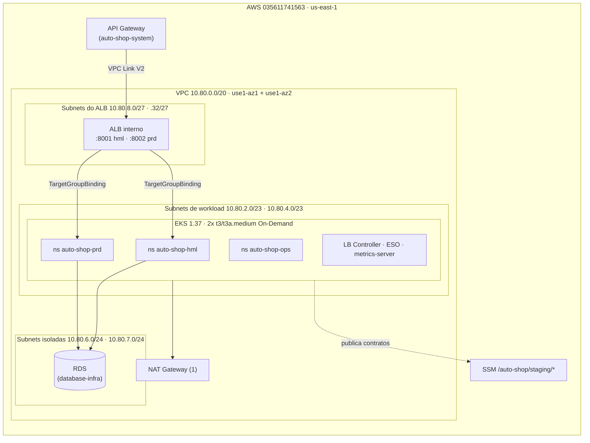

# k8s-infra

Infraestrutura Terraform do cluster Kubernetes (Amazon EKS) do **Auto Shop**, Tech Challenge Fase 3 (FIAP 13SOAT). Este repositório é dono da rede compartilhada, do cluster, do ALB interno e da base de segurança dos namespaces. Decisões: [ADR-0071](https://github.com/Software-Architecture-Group-7-FIAP/auto-shop-system/blob/develop/docs/architecture/decisions/ADR-0071-infraestrutura-cloud-fase-3.md).

| Repositório | Papel |
|---|---|
| [auto-shop-system](https://github.com/Software-Architecture-Group-7-FIAP/auto-shop-system) | Aplicação (FastAPI + Angular), deploy em `auto-shop-hml`/`auto-shop-prd`, API Gateway |
| [lambda-auth](https://github.com/Software-Architecture-Group-7-FIAP/lambda-auth) | Function serverless de autenticação por CPF |
| [database-infra](https://github.com/Software-Architecture-Group-7-FIAP/database-infra) | RDS PostgreSQL e identidades de banco |
| **k8s-infra** (este) | VPC, EKS, node group, ALB interno, add-ons, namespaces, NetworkPolicy |

## Tecnologias

Terraform 1.15 · AWS provider 6.x · `terraform-aws-modules/vpc` 6.7.3 · `terraform-aws-modules/eks` 21.29.0 · Amazon EKS 1.37 · EKS Pod Identity · AWS Load Balancer Controller 3.6.2 · External Secrets Operator 2.14.0 · VPC CNI (NetworkPolicy + prefix delegation) · GitHub Actions com OIDC · `terraform test`, tflint, checkov, shellcheck.

## Arquitetura



## Estrutura

| Caminho | Conteúdo | Ciclo de vida |
|---|---|---|
| `envs/staging/bootstrap` | Provedor OIDC do GitHub, roles `gh-plan-*` e `gh-deploy-*` dos 4 repositórios | Persistente (só IAM, custo zero) |
| `envs/staging/foundation` | VPC, subnets, NAT, EKS, node group On-Demand, add-ons EKS, ALB interno, contrato SSM | EKS/ALB descartáveis; VPC, subnets e SSM persistem; o teardown foundation aceita somente `scope=compute` |
| `envs/staging/platform` | LB Controller, ESO, Pod Identity, namespaces, quota, LimitRange, PSS, RBAC, NetworkPolicy | Efêmero (por sessão) |
| `modules/` | `network`, `alb`, `ssm-contract`, com testes `terraform test` | — |
| `scripts/` | `smoke.sh`, `orphans.sh`, `plan-summary.sh`, guards de plano e auditoria de state | — |

State: bucket `auto-shop-tfstate-035611741563-use1`, chaves `k8s-infra/staging/<stack>.tfstate`, lock nativo (`use_lockfile`).

## Contrato publicado (SSM, `/auto-shop/staging/...`)

Somente valores não secretos (`String`/`StringList`). Consumidores leem por nome exato; não usam `terraform_remote_state`.

| Parâmetro | Consumidor |
|---|---|
| `network/vpc-id`, `network/vpc-cidr` | database-infra, lambda-auth |
| `network/workload-private-subnet-ids` | lambda-auth |
| `network/rds-isolated-subnet-ids`, `network/rds-isolated-subnet-cidrs` | database-infra |
| `network/alb-subnet-cidrs` | consumido internamente (NetworkPolicy); não é um contrato de outro repositório |
| `network/eks-node-security-group-id`, `network/lambda-security-group-id` | database-infra (regra 5432), lambda-auth |
| `eks/cluster-name`, `eks/cluster-endpoint`, `eks/oidc-provider-arn` | pipelines de deploy |
| `gateway/internal-alb-arn`, `gateway/internal-alb-dns`, `gateway/internal-alb-security-group` | auto-shop-system (VPC Link) |
| `gateway/listener-arn/{hml,prd}`, `gateway/listener-port/{hml,prd}`, `gateway/target-group-arn/{hml,prd}` | auto-shop-system (Gateway e `TargetGroupBinding`) |
| `domain/root`, `domain/api-url`, `domain/frontend-url/{hml,prd}` | auto-shop-system, lambda-auth |

Convenção exigida do `database-infra`: segredo de runtime em `auto-shop/staging/<env>/app-runtime` (o ESO só lê esse padrão).

## Acesso ao cluster

| Identidade | Acesso |
|---|---|
| `gustavo-ferreira` | Cluster admin |
| `gh-deploy-k8s-infra` | Cluster admin |
| `gh-plan-k8s-infra` | Leitura (AdminView) |
| `gh-deploy-auto-shop-system` | Edit em `auto-shop-hml` e `auto-shop-prd` + `TargetGroupBinding`/`ExternalSecret` |
| `gh-deploy-database-infra` | Edit em `auto-shop-ops` (Job de bootstrap de banco) |

## Execução

Pré-requisitos: Terraform 1.15, AWS CLI v2 autenticado na conta `035611741563`, kubectl.

```bash
# Sempre que envs/staging/bootstrap mudar, ANTES do merge — rodar como o usuário IAM admin
# (gustavo-ferreira). As roles de CI não têm permissão para alterar a si mesmas, a boundary, as
# políticas de state/plan-restrictions nem o provedor OIDC (DenyEditingCiIdentities), então um PR
# que mude esse stack nunca se autoaplica; sem isso, a primeira sessão falha ao criar a role do
# cluster/node group com "NoSuchEntity: policy .../auto-shop-boundary does not exist" — depois de já
# ter criado a VPC e o NAT. Confira conta, região, recursos, custo e o plano antes de apply.
terraform -chdir=envs/staging/bootstrap init
terraform -chdir=envs/staging/bootstrap plan -out=bootstrap.tfplan
terraform -chdir=envs/staging/bootstrap show bootstrap.tfplan
# apply.yml também confere a boundary antes de aplicar foundation.
```

Pare após `terraform show`: confira a conta, a região, cada ação/recurso e o custo/budget vigente. O Terraform não estima custo. Execute a aplicação do plano salvo somente depois dessa revisão:

```bash
terraform -chdir=envs/staging/bootstrap apply -input=false bootstrap.tfplan
```

Para abrir a sessão pelos workflows do GitHub Actions, confira conta, região, cotas, créditos promocionais, budgets e custo estimado. Créditos e sua expiração são distintos do plano da conta e do budget mensal. Gere e revise um plano por stack em `ci.yml`, aplique o ID exato em `apply.yml` e feche a sessão no mesmo dia com `destroy.yml`, removendo `platform` antes de `foundation`.

## CI/CD

| Workflow | Gatilho | O que faz |
|---|---|---|
| `ci.yml` | PR para `main`; dispatch explícito em `main` pelo coordenador da aplicação | PR: validações estáticas; dispatch: recebe `session_id`, `started_at`, `session_mode`, stack, operação e `enable_nat_gateway`; salva o plano privado e um atestado do manifesto ligado ao run/attempt que o criou |
| `apply.yml` | Dispatch explícito em `main`, após revisar o plano salvo | exige o mesmo contexto, operação e valor de NAT do plano; confere o manifesto S3 com o atestado do run/attempt de origem e roda novamente o guard antes de aplicar exatamente o arquivo salvo |
| `destroy.yml` | Dispatch explícito em `main`, em etapas de plano e aplicação | mantém a platform vazia antes de foundation; foundation aceita somente `scope=compute` para EKS/ALB; `scope=all` remove somente a stack platform; confere o atestado do manifesto e aplica o plano salvo exato |
| `session-open.yml` | Dispatch pelo coordenador da aplicação | preflight local da janela e sessão explícitas; não solicita OIDC nem executa AWS/Terraform |
| `session-close.yml` | Dispatch pelo coordenador da aplicação | preflight local da janela de cleanup; o coordenador central cancela runs remotas no deadline |
| `orphan-audit.yml` | Dispatch pelo coordenador da aplicação | job read-only limitado a 13 minutos dentro da janela de 15 minutos; lê state JSON diretamente do S3 e confere recursos AWS dinâmicos; permite VPC/subnets/SSM persistentes e falha se recursos de sessão restarem |

### Sessão, planos e confirmação

No GitHub Environment `staging`, configure `STAGING_ACTIVE=true` somente para trabalho autorizado, `STAGING_SESSION_AUTHORIZED=true` após a autorização explícita e `STAGING_SESSION_MODE` para a janela aprovada. Não configure um ID ou horário diário fixo: o coordenador envia `session_id` e `started_at` explícitos em cada dispatch, e os workflows validam o contexto informado. HML pode começar entre 07:00 e 17:00 BRT, dura no máximo cinco horas e termina até 22:00; o coordenador encerra ações de teardown 20 minutos antes do cleanup calculado, reserva cinco minutos para cancelamentos e handoff e usa os 15 minutos finais para auditoria. `prd-window` é restrito a 01–05/11/2026, começa exatamente às 06:00, permite trabalho até 22:00, encerra novas ações de teardown às 22:40, reserva 22:40–22:45 para cancelamentos/handoff e executa a auditoria somente leitura entre 22:45 e 23:00 em `America/Sao_Paulo`. Um fechamento iniciado depois do deadline não despacha novas ações e ainda executa a auditoria somente leitura. Informe o mesmo ID, horário e modo em todos os workflows da sessão. A política de deployment do Environment deve continuar restrita a `main`.

### Capacidade assinada e limites de execução

Configure o secret GitHub Environment `LIFECYCLE_SESSION_SIGNING_KEY` somente quando o coordenador estiver pronto; ele fica unset por padrão. O valor é textual e precisa ter pelo menos 32 bytes em UTF-8. O coordenador assina exatamente `session_mode|session_id|started_at` com HMAC-SHA256 e envia o token em lowercase hexadecimal de 64 caracteres. `started_at` usa UTC canônico `YYYY-MM-DDTHH:MM:SSZ`; `session_mode` é `hml` ou `prd-window`. O campo `session_token` é obrigatório na interface de dispatch; o job de lifecycle verifica a assinatura antes de solicitar OIDC. Como o token é input de `workflow_dispatch`, seus metadados ficam visíveis a quem puder inspecionar a execução; limite esse acesso a operadores confiáveis e mantenha os gates PRD desligados até haver autorização curta e de uso único. Dispatch direto sem token válido falha fechado.

`lifecycle_dispatch_id` ? obrigat?rio em CI/apply/destroy/auditoria, precisa ter 32 caracteres hexadecimais min?sculos e ? acrescentado ao `run-name` para correla??o. Antes de solicitar OIDC, os workflows consultam o hist?rico e rejeitam um ID j? usado; a API do GitHub indispon?vel ou com resposta inv?lida bloqueia a execu??o. Reruns de workflows de lifecycle s?o rejeitados, mesmo mantendo o mesmo `run_id`. O coordenador injeta esse ID e revalida/cancela runs correlacionados no deadline. Antes de baixar o atestado, apply/destroy validam pela API o workflow, branch, commit, attempt e conclus?o bem-sucedida que originaram o `plan_id`; falhas na API bloqueiam a execu??o. Os workflows revalidam a sess?o antes de enviar um plano ao S3 e antes de iniciar apply/destroy. HML rejeita qualquer a??o, inclusive cleanup/grace, depois de 31/10/2026 BRT.

Não há schedules independentes neste repositório. O único coordenador fica no repositório da aplicação e dispara estes workflows com a sessão explícita. As flags `ENVIRONMENT_SCHEDULE_ENABLED`, `PRD_LIFECYCLE_AUTOMATION_READY` e `PRD_COST_EXCEPTION_APPROVED` ficam unset ou `false` por padrão e só podem ser habilitadas depois da configuração e dos pré-requisitos, incluindo dois ciclos completos. A abertura PRD exige as três flags; cleanup e auditoria de uma sessão já assinada continuam permitidos se os gates de abertura forem revogados. A abertura real usa `ci.yml` e `apply.yml`; o fechamento remove primeiro `platform`, depois `module.eks` e `module.alb` por `scope=compute`, preservando VPC, subnets e contrato SSM. NAT é desligado em um plano separado `ci.yml`/`apply.yml` com `operation=nat-disable` e `enable_nat_gateway=false`. O dispatch final de `orphan-audit.yml` verifica state e AWS somente para leitura. `scope=all` está disponível somente para destruir a stack platform; foundation nunca permite destruir VPC, subnets ou contrato SSM pelo workflow.

O dispatch de `ci.yml` cria um plano para uma stack por vez. Ele valida a conta `035611741563`, a região `us-east-1`, sessão, janela e confirmação de modo do Environment. `operation=open` exige `enable_nat_gateway=true` e rejeita qualquer delete/replacement; `operation=nat-disable` exige foundation com `enable_nat_gateway=false` e aceita somente deletes de NAT, EIP e rotas NAT. Depois mostra endereços e ações de recursos sem imprimir valores sensíveis e grava o plano Terraform e seu manifesto/checksum (incluindo sessão, modo e escopo) sob `k8s-infra/staging/plans/` no bucket de state existente. Também calcula o SHA-256 exato do manifesto e o guarda como artefato imutável associado ao run ID e attempt de origem; apply/destroy precisam baixar esse artefato e conferir o manifesto S3 antes de confiar nele. Assim, substituir juntos o plano e o manifesto no S3 não substitui o valor de referência ligado ao run. O upload S3 usa SSE-S3 e o escopo IAM de state do repositório. A role de plano mantém `ReadOnlyAccess` para APIs de serviços AWS, com negações explícitas para leituras sensíveis. A policy S3 custom limita `ListBucket` às chaves exatas de state, permite `GetObject` somente nesses states e `PutObject` somente em `k8s-infra/staging/plans/*`. Ela não permite escrever ou excluir state nem lockfile. Os planos usam `terraform plan -lock=false`; apply e destroy usam a role de deploy para locks. O plano salvo pode conter valores sensíveis.

`apply.yml` exige stack, ID do plano, sessão, início UTC, modo, operação, configuração NAT e confirmação literal `apply`. Antes de usá-lo, confira conta, região, ações/recursos do plano e o custo/budget atual. O Terraform não estima custo AWS; use a visão de billing e os budgets vigentes. O apply só aceita o mesmo commit, sessão, início, modo, escopo, versão Terraform e checksum do plano revisado; roda o guard novamente e apaga os objetos exatos do plano após sucesso. Um plano abandonado permanece no prefixo até uma limpeza autorizada. Este repositório não gerencia a lifecycle configuration do bucket S3 compartilhado: substituí-la sem conhecer as regras atuais poderia remover regras de retenção de outros repositórios. A expiração dos planos e das versões antigas continua pendente de análise com o proprietário do bucket; não foi feita leitura AWS para verificar essa configuração. Com credenciais autorizadas, uma limpeza manual usa `bash scripts/delete-plan-artifact.sh PLAN_ID apply STACK` (ou `destroy`); o script confere conta e região antes de excluir apenas os dois objetos daquele plano. O role de plano só aceitará o Environment `staging` após o stack `bootstrap` aplicar a nova trust policy de leitura.

Para teardown, use `destroy.yml` com `operation=plan`, stack, `scope`, sessão, início UTC e modo autorizados. `scope=compute` só é válido para foundation e restringe o plano a exclusões puras em `module.eks` e `module.alb`; o guard bloqueia qualquer alteração em rede ou contrato SSM. `scope=all` só é válido para platform. A platform precisa estar vazia antes de planejar foundation, e é verificada novamente antes da aplicação. Revise as ações, conta, região e custo no resumo. Depois execute outro dispatch com `operation=destroy`, o mesmo ID do plano e `confirm=destroy`; o manifesto obriga a repetição do mesmo escopo e contexto. As operações mutáveis de teardown têm limite de 13 minutos e exigem tempo restante para concluir antes do cutoff calculado (22:40 BRT em PRD); a auditoria read-only usa até 13 minutos dentro da reserva 22:45–23:00 BRT. O bootstrap continua exigindo aplicação manual pelo usuário admin quando mudar.

`orphan-audit.yml` assume a role OIDC dedicada `AWS_AUDIT_ROLE_ARN`, criada pelo bootstrap, e usa somente ações AWS `List`/`Describe`, `sts:GetCallerIdentity`, S3 `ListBucket` nos dois prefixos exatos e `GetObject` nos dois state keys. A role não recebe `ReadOnlyAccess`, `GetSecretValue` ou leitura de valores SSM. Baixa os states sem `terraform init` ou escrita de lockfile para diretório temporário com permissões 700/600, analisa somente endereços e contagens e remove os arquivos no encerramento do step. Verifica que `platform` não tem recursos gerenciados e que foundation mantém somente `module.network` e `module.contract`, sem endereços de NAT. Depois exige ausência de EKS, ALB, target groups, NAT/EIP, instâncias, volumes, RDS, snapshots e logs de cluster. A rede VPC/subnets e os parâmetros SSM persistentes podem continuar no state e na conta durante PRD. HML permite dispatch manual da auditoria com o gate de schedule desligado; PRD também permite a auditoria pós-cleanup sem depender dos gates de abertura, usando somente o token assinado e a janela autorizada antes de solicitar OIDC read-only.

Copie o output `orphan_audit_role_arn` do bootstrap para a variável `AWS_AUDIT_ROLE_ARN` do GitHub Environment `staging` depois de aplicar manualmente a mudança do bootstrap.

Pull requests executam validações estáticas e não chamam APIs AWS. Os workflows não fazem apply nem destroy por merge.

Autenticação somente por OIDC (variáveis `AWS_PLAN_ROLE_ARN`, `AWS_DEPLOY_ROLE_ARN` e `AWS_AUDIT_ROLE_ARN`); nenhuma access key. As trust policies usam só os claims `aud` e `sub`, comparado com `StringLike` e os segmentos de ID do GitHub em wildcard no meio da string (nunca no início — a AWS rejeita padrões "não escopados"): o GitHub passou a incluir IDs numéricos imutáveis no `sub` para esta organização (`repo:ORG@id/REPO@id:...`), quebrando comparação simples. O papel de plan é usado somente pelo dispatch manual em `main`, depois do gate da sessão; PRs não assumem a role. O papel de deploy aceita `environment:<nome>` para cada GitHub Environment listado (`staging` para este repositório), com a restrição de branch vindo da política de deployment-branch do próprio Environment (configurada fora do Terraform, restrita a `main`) — não de uma condição IAM. O papel de auditoria só aceita o Environment `staging` deste repositório. Validação empírica em 26/10/2026 nesta conta confirmou que, embora `repository`, `event_name`, `environment` e `job_workflow_ref` estejam no token, o STS não os aceita como condições de trust; exigir qualquer um tornou a role inassumível.O CI verifica a política do Environment `staging` nas execuções de PR e de dispatch. O papel de plan nega leituras sensíveis que o `ReadOnlyAccess` concederia por padrão (segredos, DynamoDB, parâmetros SSM fora de `/auto-shop/*` e fora do namespace público `aws/service/*` da própria AWS). Ações de terceiros fixadas por SHA de commit.

## Custo (us-east-1, preços públicos de 2026-10-25)

| Item | US$/h |
|---|---|
| EKS control plane | 0,100 |
| 2 nodes On-Demand t3/t3a.medium (até 2 × t3.medium) | 0,083 |
| NAT Gateway + IPv4 | 0,050 |
| ALB interno + 1 LCU | 0,031 |
| **Total deste repositório** | **~0,26** |

Os valores acima são uma estimativa de arquitetura, não uma leitura da conta, um budget ou uma autorização para executar. Antes de apply ou destroy, confira o custo e o budget atuais na conta; o Terraform não calcula custo. O repositório não tem teardown agendado: quando habilitado, o coordenador único da aplicação dispara as etapas explícitas de fechamento e auditoria. Os planos privados usam o bucket de state existente e acrescentam armazenamento e requisições S3; o custo exato e a retenção real do bucket não foram verificados.

## Segurança: controles implementados

- **Permissions boundary** (`auto-shop-boundary`, mesmo formato do `PowerUserAccess`) obrigatória nas roles criadas pela CI sob `/auto-shop/`. Uma role de deploy não consegue criar outra role, anexar `AdministratorAccess` e assumi-la para escapar do próprio limite: o `iam:CreateRole` só é permitido com a boundary já anexada, e nada tem permissão para removê-la ou trocá-la depois.
- **`iam:PassRole` condicionado a `iam:PassedToService`**: uma role de deploy só repassa roles do projeto para os serviços AWS que realmente as assumem (EKS, EC2, Lambda, Pod Identity), não para qualquer destino.
- **Isolamento de state entre repositórios** por `Deny` em `s3:*` (não só pelas três ações de leitura/escrita) nos prefixos dos outros três repositórios, incluindo `GetObjectVersion` num bucket versionado.
- **OIDC do deploy restrito por Environment + política de branch do GitHub**: a trust policy exige `sub = repo:ORG@*/REPO@*:environment:staging`; a política de deployment-branch do Environment `staging` (restrita a `main`, configurada no GitHub) é o que impede um `workflow_dispatch` de outra branch — o GitHub nem chega a emitir o token nesse caso. Não há condição IAM em `job_workflow_ref`: a validação empírica nesta conta mostrou que o STS não aceita esse claim como condição.
- **Pod Identity com `aws:SourceArn`**: a trust do LB Controller e do ESO está pinada a este cluster especificamente, não a "qualquer cluster desta conta".
- **Política do LB Controller reduzida** à reconciliação de `TargetGroupBinding` (`RegisterTargets`/`DeregisterTargets` + leituras); a política oficial da AWS inclui criação/edição de ALB, listener, regra, SG e associação de WAF/Shield, que este repositório não usa (o ALB é criado pelo próprio Terraform).
- **Logs de auditoria do control plane** habilitados (`api`, `audit`, `authenticator`), não só `api`/`authenticator`.

## Decisões de segurança aceitas

Registradas no ADR-0071 e suprimidas em `.checkov.yaml`:

- **Endpoint do EKS público + privado**, autenticado por IAM (access entries), para evitar runner CodeBuild dentro da VPC.
- **ALB interno em HTTP**: só alcançável dentro da VPC pelo VPC Link; TLS termina no API Gateway.
- **Sem access logs no ALB** e sem deletion protection (ambiente efêmero).
- **NetworkPolicy em modo `standard`** com default-deny explícito nos namespaces do projeto; o modo `strict` bloquearia add-ons de `kube-system` sem políticas. Em `auto-shop-ops`, o acesso ao EKS Pod Identity agent fica limitado a `169.254.170.23/32` nas portas TCP `80` e `2703`; os demais destinos link-local continuam bloqueados.
- **Roles de deploy com `PowerUserAccess`** e política IAM restrita ao path `/auto-shop/`; elas não podem alterar as próprias identidades nem acessar o state de outros repositórios. Roles criadas por elas precisam carregar `auto-shop-boundary`. A boundary não está anexada às roles de deploy porque bloqueia o bucket compartilhado usado pelo Terraform state.
- **Sem criptografia de Secrets por CMK adicional**: o etcd já é criptografado pela chave padrão gerenciada pela AWS; uma CMK extra ficaria em `PendingDeletion` por 7 dias após cada teardown, com custo residual. Reavaliar num ambiente de vida mais longa.
- **Pull requests não assumem roles AWS**: o CI de PR executa validações estáticas. A role `gh-plan-*` só é assumida por dispatch manual protegido em `main`; PRs não entram na trust policy.

### Acesso ao endpoint do EKS

O endpoint público da API Kubernetes aceita somente CIDRs administrativos confiáveis. Configure a variável de repositório do GitHub Actions `EKS_CLUSTER_ENDPOINT_ADMIN_CIDRS` como uma lista JSON, por exemplo, `["203.0.113.10/32"]`, e mantenha nela apenas redes administrativas. O Terraform aceita somente CIDRs IPv4 canônicos, únicos e restritos (prefixos `/1` a `/32`). O plano também verifica que o endpoint público e privado continuam ativos e que a allowlist corresponde exatamente à variável configurada.

Os workflows de apply e destroy acrescentam o IP de saída do runner apenas durante as operações no Kubernetes e restauram a lista administrativa ao final. O plano da stack platform é pulado no CI quando o runner não está na allowlist. Para executar essa stack localmente, defina `TF_VAR_cluster_endpoint_public_access_cidrs` com a lista JSON dos CIDRs administrativos autorizados.

## Limitações conhecidas

- Quota de vCPU standard da conta: 5 (pedido de aumento aberto). O node group é fixo em 2 nodes; Cluster Autoscaler está fora do escopo.
- Probes de Redis/MailHog em portas diferentes de 8000 podem precisar de NetworkPolicy adicional no repositório da aplicação.
- Parâmetros do node group (`maxPods`, AMI, versão do Kubernetes) são efetivamente imutáveis dentro de uma sessão: com a quota de 5 vCPU já no limite com 2 nodes de 2 vCPU, uma atualização in-place exigiria capacidade de surge que a conta não tem. Mudar esses parâmetros destruindo e recriando o stack `foundation`, não aplicando sobre um cluster em execução.
- Depois da primeira sessão, verificar se os access entries reconhecem corretamente os ARNs com path (`arn:aws:iam::...:role/auto-shop/gh-deploy-k8s-infra`) quando assumidos via OIDC — a ARN de sessão do STS não carrega o path, e o EKS historicamente exigia a forma sem path em cenários parecidos. `enable_cluster_creator_admin_permissions = true` cobre esse risco como rede de segurança.
## Decisões e diagramas da Fase 3

As decisões arquiteturais compartilhadas estão no [auto-shop-system](https://github.com/Software-Architecture-Group-7-FIAP/auto-shop-system/blob/develop/docs/architecture/diagramas-fase-3.md).

- [ADR-0075: HPA sem Cluster Autoscaler](https://github.com/Software-Architecture-Group-7-FIAP/auto-shop-system/blob/develop/docs/architecture/decisions/ADR-0075-hpa-sem-cluster-autoscaler.md)
- [ADR-0077: HML e PRD por namespace](https://github.com/Software-Architecture-Group-7-FIAP/auto-shop-system/blob/develop/docs/architecture/decisions/ADR-0077-hml-prd-por-namespace.md)
- [RFC-0001: escolha de AWS](https://github.com/Software-Architecture-Group-7-FIAP/auto-shop-system/blob/develop/docs/rfc/RFC-0001-escolha-cloud-aws.md)
- [Diagrama de componentes da Fase 3](https://github.com/Software-Architecture-Group-7-FIAP/auto-shop-system/blob/develop/docs/architecture/diagrams/componentes-fase-3.svg)
