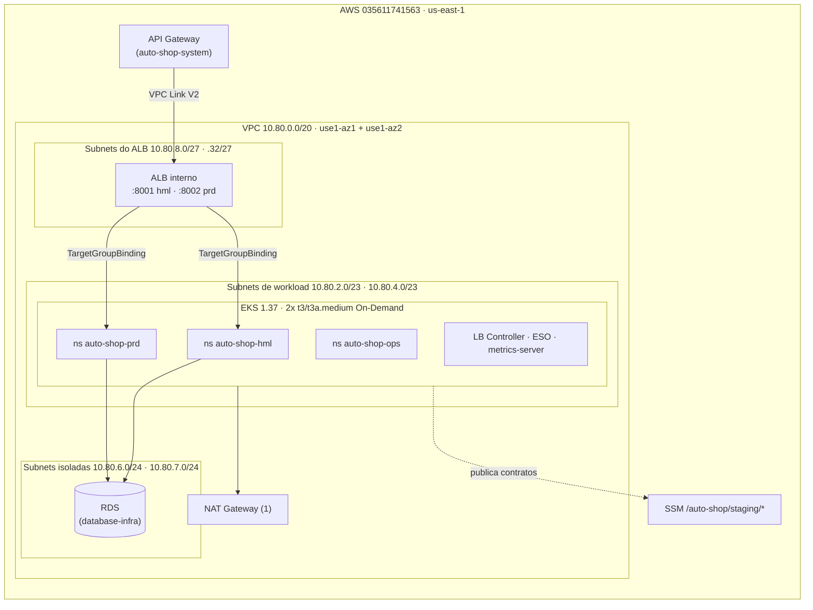

# k8s-infra

Infraestrutura Terraform do cluster Kubernetes (Amazon EKS) do **Auto Shop**, Tech Challenge Fase 3 (FIAP 13SOAT). Este repositório é dono da rede compartilhada, do cluster, do ALB interno e da base de segurança dos namespaces. Decisões: [ADR-0071](https://github.com/Software-Architecture-Group-7-FIAP/auto-shop-system/blob/develop/docs/architecture/decisions/ADR-0071-infraestrutura-cloud-fase-3.md).

| Repositório | Papel |
|---|---|
| [auto-shop-system](https://github.com/Software-Architecture-Group-7-FIAP/auto-shop-system) | Aplicação (FastAPI + Angular), deploy em `auto-shop-hml`/`auto-shop-prd`, API Gateway |
| [lambda-auth](https://github.com/Software-Architecture-Group-7-FIAP/lambda-auth) | Function serverless de autenticação por CPF |
| [database-infra](https://github.com/Software-Architecture-Group-7-FIAP/database-infra) | RDS PostgreSQL e identidades de banco |
| **k8s-infra** (este) | VPC, EKS, node group, ALB interno, add-ons, namespaces, NetworkPolicy |

## Tecnologias

Terraform 1.15 · AWS provider 6.x · `terraform-aws-modules/vpc` 6.7.3 · `terraform-aws-modules/eks` 21.29.0 · Amazon EKS 1.37 · EKS Pod Identity · AWS Load Balancer Controller 3.6.2 · External Secrets Operator 2.14.0 · VPC CNI (NetworkPolicy + prefix delegation) · GitHub Actions com OIDC · `terraform test`, tflint, checkov, shellcheck.

## Arquitetura



## Estrutura

| Caminho | Conteúdo | Ciclo de vida |
|---|---|---|
| `envs/staging/bootstrap` | Provedor OIDC do GitHub, roles `gh-plan-*` e `gh-deploy-*` dos 4 repositórios, role HML sem PowerUser | Persistente (só IAM, custo zero) |
| `envs/staging/foundation` | VPC, subnets, NAT, EKS, node group On-Demand, add-ons, ALB interno, contrato SSM e runner privado CodeBuild | EKS/ALB descartáveis; VPC, subnets, SSM e configuração do runner persistem; o teardown foundation aceita somente `scope=compute` |
| `envs/staging/platform` | Shared LB Controller, ESO, Pod Identity roles, ECR, and ops namespace | Shared stack; removed only by its own reviewed teardown |
| `envs/hml` | Recursos namespaced HML, NetworkPolicy, SecretStore, and migration identity; it reads the precreated namespace | Isolated state; namespace/RBAC bootstrap remains external |
| `envs/production` | PRD namespace, quota, RBAC, NetworkPolicy, SecretStore, and migration identity | Isolated state; teardown removes PRD-owned resources only |
| `modules/` | `network`, `alb`, `ssm-contract`, `application-environment`, com testes `terraform test` | — |
| `scripts/` | `smoke.sh`, `orphans.sh`, `plan-summary.sh`, guards de plano e auditoria de state | — |

State: bucket `auto-shop-tfstate-035611741563-use1`; shared roots use `k8s-infra/staging/<stack>.tfstate`, while HML and PRD use `k8s-infra/hml/terraform.tfstate` and `k8s-infra/production/terraform.tfstate`; native lock (`use_lockfile`).

### Raizes de ambiente e state readiness

`envs/staging/foundation` remains the sole owner of the shared VPC, EKS cluster, internal ALB, listeners, target groups, HML EKS access entries, and the persistent CodeBuild runner project and service role. The runner itself is an ephemeral VPC build, not a long-running instance. `envs/staging/platform` remains the owner of shared controllers, IAM, ECR, and `auto-shop-ops`. `envs/hml` manages resources inside the precreated namespace `auto-shop-hml`; it does not create or delete that Namespace object. `envs/production` maps to `auto-shop-prd`, but PRD apply is disabled. Their backend keys are independent, and neither environment root declares shared foundation or platform resources.

The existing `k8s-infra/staging/foundation.tfstate` remains the owner of shared VPC, EKS, NAT, ALB, and SSM resources; the private runner resources are added to this same owner state by a reviewed foundation apply. `k8s-infra/staging/platform.tfstate` continues to own the shared ECR repository. Existing state ownership means no shared-resource state migration is required. No HML or production state objects exist yet; their state keys start empty, remain independent, and own only their environment namespace-scoped resources when readiness is approved. These environment roots must not import or declare shared foundation/platform resources.

The branch pipeline is a static HML readiness check only: it never requests AWS credentials or applies Terraform. The reviewed session path fails closed until `K8S_HML_TERRAFORM_ROOT_READY` and the application's `K8S_PRIVATE_RUNNER_PREREQUISITES_READY` are explicitly approved. `K8S_PRODUCTION_TERRAFORM_ROOT_READY` remains unset and PRD has no Apply choice or branch-pipeline trust. The presence of the new roots is not deployment authorization; no state migration or environment-root state write has been performed.

### HML bootstrap prerequisite

Before any HML plan/apply, an authorized cluster administrator must apply `.github/hml-namespace-bootstrap.yaml`. This creates `auto-shop-hml` with restricted Pod Security labels and namespaced RBAC for the HML app deploy group and the HML infrastructure group. The HML Terraform root only reads the namespace. Its GitHub role `gh-deploy-k8s-hml` receives `AmazonEKSAdminPolicy` scoped to `auto-shop-hml`, plus narrowly tagged HML migration-association permissions and access to `k8s-infra/hml/terraform.tfstate`; it has no `PowerUserAccess`. It cannot create/delete Kubernetes Namespace objects or access another namespace. The application's `auto-shop-staging-github-staging` role receives `AmazonEKSEditPolicy` scoped to the same namespace. Shared foundation owns both EKS access entries and associations.

Bootstrap order is the GitHub runner group and AWS CodeConnections authorization described below, IAM role configuration, cluster-admin application of the namespace/RBAC manifest, reviewed foundation apply for the HML access entries and private runner project, a current `platform` apply (its External Secrets Operator install for `auto-shop-hml` must already be running — `envs/hml`'s `SecretStore`/`ExternalSecret` resources are `kubernetes_manifest` objects whose CRD must already exist for `terraform plan` to succeed), then the coordinator's session-gated `cluster-ci.yml`/`cluster-apply.yml` plan/apply. Configure `AWS_HML_DEPLOY_ROLE_ARN` to `arn:aws:iam::035611741563:role/auto-shop/gh-deploy-k8s-hml`. HML state teardown leaves the namespace and bootstrap RBAC in place; they are removed separately by an authorized cluster administrator when the shared cluster is retired.

### Private EKS runner setup

The public repository's cluster workflows run only in the private CodeBuild runner inside the foundation VPC. Before opening a coordinated session:

1. In the `Software-Architecture-Group-7-FIAP` GitHub organization, create the custom runner group named `k8s-private-eks`. Restrict it to this repository and selected workflows on `refs/heads/main`: `.github/workflows/cluster-ci.yml`, `.github/workflows/cluster-apply.yml`, and `.github/workflows/cluster-destroy.yml`.
2. In AWS account `035611741563`, region `us-east-1`, open the pending connection `auto-shop-k8s-private-runner` in Developer Tools > Settings > Connections. Authorize the AWS Connector for GitHub for the `Software-Architecture-Group-7-FIAP` organization, grant it access only to `k8s-infra`, and wait for `AVAILABLE` before the foundation apply. CodeBuild uses this connection for the project source and workflow-job webhook.
3. Add these repository variables in `k8s-infra`: `ENABLE_PRIVATE_EKS_RUNNER=true`, `GITHUB_RUNNER_GROUP_ID=<custom group ID greater than 1>`, and `GITHUB_CODECONNECTION_ARN=<authorized connection ARN>`.
4. Set `K8S_PRIVATE_RUNNER_PREREQUISITES_READY=true` in the application repository only after steps 1–3. The coordinator then applies the runner project during the foundation opening step before dispatching platform/HML jobs.

The runner security group has no ingress and only TCP/443 egress. EKS private endpoint access is checked by private DNS resolution and a TCP/443 probe; public administrator CIDRs remain unchanged. CodeBuild uses on-demand compute and bills for build duration, rounded up to the nearest minute; no build runs while the project is idle. The project limits concurrency to two and retains its logs for one day. See [CodeBuild runner setup](https://docs.aws.amazon.com/codebuild/latest/userguide/action-runner.html) and [current CodeBuild pricing](https://aws.amazon.com/codebuild/pricing/).

## Contrato publicado (SSM, `/auto-shop/staging/...`)

Somente valores não secretos (`String`/`StringList`). Consumidores leem por nome exato; não usam `terraform_remote_state`.

| Parâmetro | Consumidor |
|---|---|
| `network/vpc-id`, `network/vpc-cidr` | database-infra, lambda-auth |
| `network/workload-private-subnet-ids` | lambda-auth |
| `network/rds-isolated-subnet-ids`, `network/rds-isolated-subnet-cidrs` | database-infra |
| `network/alb-subnet-cidrs` | consumido internamente (NetworkPolicy); não é um contrato de outro repositório |
| `network/eks-node-security-group-id`, `network/lambda-security-group-id` | database-infra (regra 5432), lambda-auth |
| `eks/cluster-name`, `eks/cluster-endpoint`, `eks/oidc-provider-arn` | pipelines de deploy |
| `gateway/internal-alb-arn`, `gateway/internal-alb-dns`, `gateway/internal-alb-security-group` | auto-shop-system (VPC Link) |
| `gateway/listener-arn/{hml,prd}`, `gateway/listener-port/{hml,prd}`, `gateway/target-group-arn/{hml,prd}` | auto-shop-system (Gateway e `TargetGroupBinding`) |
| `domain/root`, `domain/api-url`, `domain/frontend-url/{hml,prd}` | auto-shop-system, lambda-auth |

Convenção exigida do `database-infra`: segredo de runtime em `auto-shop/staging/<env>/app-runtime` (o ESO só lê esse padrão).

## Acesso ao cluster

| Identidade | Acesso |
|---|---|
| `gustavo-ferreira` | Cluster admin |
| `gh-deploy-k8s-infra` | Cluster admin |
| `gh-deploy-k8s-hml` | `AmazonEKSAdminPolicy` scoped to `auto-shop-hml`; no cluster-wide access |
| `auto-shop-staging-github-staging` | `AmazonEKSEditPolicy` scoped to `auto-shop-hml` |
| `gh-plan-k8s-infra` | Leitura (AdminView) |
| `gh-deploy-auto-shop-system` | Edit em `auto-shop-hml` e `auto-shop-prd` + `TargetGroupBinding`/`ExternalSecret` |
| `gh-deploy-database-infra` | Edit em `auto-shop-ops` (Job de bootstrap de banco) |

## Isolamento HML/PRD (#05)

`envs/hml` e `envs/production` usam state keys distintas e gerenciam recursos namespaced; o Namespace HML é precriado fora do state por um administrador autorizado. A branch pipeline apenas valida o root HML; deploy acontece somente via plano salvo e sessão autorizada. PRD apply está desabilitado. A foundation continua como único dono da VPC, EKS, ALB interno, listeners, target groups e HML EKS access entries; `platform` continua dono dos controllers compartilhados, IAM, ECR e namespace ops. A política de ingress da API aceita tráfego vindo apenas das subnets dedicadas do ALB. Os nodes do EKS ficam nas subnets privadas de workload, e as subnets isoladas do RDS não têm rota para NAT nem Internet Gateway.

O External Secrets usa controllers e identidades Pod Identity separados para HML e PRD, cada controller limitado ao namespace da própria aplicação e à respectiva chave `auto-shop/staging/<env>/app-runtime`. Apenas o controller HML instala as CRDs; stores e ExternalSecrets são recursos namespaced de cada raiz de ambiente. As roles de migração também são separadas (`auto-shop-staging-db-migrate-hml` e `auto-shop-staging-db-migrate-prd`) e recebem as policies de leitura publicadas pelo `database-infra` em `/auto-shop/staging/database/iam/migrations-{hml,prd}-read-policy-arn`.

O ALB tem listeners e target groups distintos: HML usa listener `8001`, PRD usa listener `8002`, e ambos encaminham para targets IP na porta `8000`. O `TargetGroupBinding` é responsabilidade do repositório `auto-shop-system`, em `k8s/base/ingress`; cada overlay deve vincular seu namespace e Service ao ARN SSM do mesmo estágio (`gateway/target-group-arn/hml` ou `gateway/target-group-arn/prd`). O Service publica a porta `80` e encaminha para o container na porta `8000`. O deploy do app aplica os bindings depois da CRD do AWS Load Balancer Controller e da migration.

O isolamento de banco ainda não está concluído. A configuração atual de `database-infra` provisiona uma instância e endpoint RDS compartilhados por HML e PRD, com o mesmo security group. Além disso, as NetworkPolicies deste repositório permitem que ambos os namespaces acessem PostgreSQL nas mesmas subnets isoladas. Portanto, namespaces e target groups separados não significam bancos isolados. O critério de isolamento de dados depende de endpoints e regras de segurança distintos por estágio em `database-infra`, seguidos por regras de egress específicas por namespace; não foram inventados CIDRs para representar essa separação.

O módulo do ALB não cria regras de ingress. O repositório `auto-shop-system` é dono dessas regras porque também cria o security group do VPC Link; com `enable_alb_security_group_rules=true`, ele permite as portas dos listeners somente a partir desse security group. Mantenha essa opção habilitada para o ALB aceitar tráfego do API Gateway e não de outros workloads da VPC.

Para fechar a verificação operacional ainda são necessários o apply das stacks, confirmação de que a regra de ingress referencia apenas o SG do VPC Link, de que cada TGB registra apenas os IPs do namespace correspondente, health checks saudáveis nos dois target groups e chamadas sintéticas HML/PRD que comprovem o roteamento pelo listener/API correto. Esses resultados dependem da conta AWS e não foram verificados neste checkout.

## Execução

Pré-requisitos: Terraform 1.15, AWS CLI v2 autenticado na conta `035611741563`, kubectl.

```bash
# Sempre que envs/staging/bootstrap mudar, ANTES do merge — rodar como o usuário IAM admin
# (gustavo-ferreira). As roles de CI não têm permissão para alterar a si mesmas, a boundary, as
# políticas de state/plan-restrictions nem o provedor OIDC (DenyEditingCiIdentities), então um PR
# que mude esse stack nunca se autoaplica; sem isso, a primeira sessão falha ao criar a role do
# cluster/node group com "NoSuchEntity: policy .../auto-shop-boundary does not exist" — depois de já
# ter criado a VPC e o NAT. Confira conta, região, recursos, custo e o plano antes de apply.
terraform -chdir=envs/staging/bootstrap init
terraform -chdir=envs/staging/bootstrap plan -out=bootstrap.tfplan
terraform -chdir=envs/staging/bootstrap show bootstrap.tfplan
# apply.yml também confere a boundary antes de aplicar foundation.
```

Pare após `terraform show`: confira a conta, a região, cada ação/recurso e o custo/budget vigente. O Terraform não estima custo. Execute a aplicação do plano salvo somente depois dessa revisão:

```bash
terraform -chdir=envs/staging/bootstrap apply -input=false bootstrap.tfplan
```

Para abrir a sessão pelos workflows do GitHub Actions, confira conta, região, cotas, créditos promocionais, budgets e custo estimado. Créditos e sua expiração são distintos do plano da conta e do budget mensal. O coordenador mantém `foundation` em `ci.yml`/`apply.yml` e usa os workflows privados `cluster-ci.yml`/`cluster-apply.yml` para `platform` e `hml`. No fechamento, remove `hml`, `platform` e o compute de `foundation` antes de desligar NAT por último; o audit read-only roda após essas etapas. PRD apply permanece desabilitado.

## CI/CD

| Workflow | Gatilho | O que faz |
|---|---|---|
| `ci.yml` | PR para `develop` e `main`; dispatch explícito em `main` pelo coordenador da aplicação | PR: validações estáticas; dispatch: recebe `session_id`, `started_at`, `session_mode`, stack, operação e `enable_nat_gateway`; salva o plano privado e um atestado do manifesto ligado ao run/attempt que o criou |
| `apply.yml` | Dispatch explícito em `main`, após revisar o plano salvo | exige o mesmo contexto, operação e valor de NAT do plano; HML usa `AWS_HML_DEPLOY_ROLE_ARN`, e foundation/platform usam `AWS_DEPLOY_ROLE_ARN`; confere o manifesto S3 com o atestado do run/attempt de origem e roda novamente o guard antes de aplicar exatamente o arquivo salvo |
| `destroy.yml` | Dispatch explícito em `main`, em etapas de plano e aplicação | HML usa a role isolada e é removido antes de platform/foundation; PRD teardown permanece bloqueado pela ausência de acesso ao state isolado; foundation aceita somente `scope=compute` |
| `cluster-ci.yml` | Dispatch explícito em `main` pelo coordenador | Plano isolado de HML/platform no runner CodeBuild dentro da VPC; mantém ledger de uso único, guard e atestado de plano |
| `cluster-apply.yml` | Dispatch explícito em `main` após revisão | Aplica somente planos HML/platform criados por `cluster-ci.yml`, após verificar run, commit, attempt e atestado |
| `cluster-destroy.yml` | Dispatch explícito em `main`, em etapas de plano e aplicação | Planeja e aplica teardown HML/platform no runner privado; foundation compute e NAT continuam nos workflows hosted |
| `session-open.yml` | Dispatch pelo coordenador da aplicação | preflight local da janela e sessão explícitas; não solicita OIDC nem executa AWS/Terraform |
| `session-close.yml` | Dispatch pelo coordenador da aplicação | preflight local da janela de cleanup; o coordenador central cancela runs remotas no deadline |
| `orphan-audit.yml` | Dispatch pelo coordenador da aplicação | job read-only limitado a 13 minutos dentro da janela de 15 minutos; lê state JSON diretamente do S3 e confere recursos AWS dinâmicos; permite VPC/subnets/SSM e o serviço persistente do runner; falha se recursos de sessão restarem |
| `branch-pipeline.yml` | PR e push em `develop`; sem OIDC/AWS | valida apenas o root HML e mostra o handoff para o fluxo de plano salvo e sessão autorizada; nunca aplica Terraform |

### Sessão, planos e confirmação

No GitHub Environment `staging`, configure `STAGING_ACTIVE=true` somente para trabalho autorizado, `STAGING_SESSION_AUTHORIZED=true` após a autorização explícita e `STAGING_SESSION_MODE` para a janela aprovada. Não configure um ID ou horário diário fixo: o coordenador envia `session_id` e `started_at` explícitos em cada dispatch, e os workflows validam o contexto informado. HML pode começar entre 07:00 e 17:00 BRT, dura no máximo cinco horas e termina até 22:00; o coordenador encerra ações de teardown 20 minutos antes do cleanup calculado, reserva cinco minutos para cancelamentos e handoff e usa os 15 minutos finais para auditoria. `prd-window` é restrito a 01–05/11/2026, começa exatamente às 06:00 e permite trabalho por no máximo cinco horas (até 11:00 BRT). O coordenador fecha automaticamente a sessão nesse limite, encerra novas ações de teardown às 22:40, reserva 22:40–22:45 para cancelamentos/handoff e executa a auditoria somente leitura entre 22:45 e 23:00 em `America/Sao_Paulo`. Um fechamento iniciado depois do deadline não despacha novas ações e ainda executa a auditoria somente leitura. Informe o mesmo ID, horário e modo em todos os workflows da sessão. A política de deployment do Environment deve continuar restrita a `main`.

Antes de assumir as roles consumidoras de lifecycle, `apply.yml`, `ci.yml`, `destroy.yml` e `orphan-audit.yml` verificam que `github.triggering_actor` corresponde a `GITHUB_ACTOR`, e que ambos correspondem aos operadores autorizados e ao ator do token de dispatch registrado na sessão. Isso bloqueia reruns por outro usuário. Configure a allowlist exata `LIFECYCLE_TRUSTED_OPERATORS` e inclua a identidade do token que o coordenador usa para dispatch entre repositórios; se estiver ausente ou não incluir o ator, a execução falha antes de solicitar OIDC. O actor pode ser o usuário dono de um PAT ou o login `[bot]` de um GitHub App, e pode diferir do operador humano que abriu a sessão.

### Autorização de dispatch e limites de execução

Não use `LIFECYCLE_SESSION_SIGNING_KEY` nem `session_token`: a autorização HMAC foi substituída pelo ledger DynamoDB persistente do coordenador. Para cada workflow dispatch, o coordenador grava uma autorização de uso único com o hash SHA-256 canônico de todos os inputs finais, inclusive `lifecycle_dispatch_id`, o operador de origem e o ator esperado do token de dispatch. O workflow assume primeiro a role OIDC consumidora dedicada a esse nome (`CI`, `Apply`, `Destroy` ou `Orphan Audit`), com o Environment `staging` e `refs/heads/main`; faz `GetItem` consistente da autorização e da sessão, exige que o operador de origem corresponda ao operador armazenado e que `GITHUB_ACTOR` corresponda ao ator de dispatch registrado, e então faz `UpdateItem` condicional verificando status, expiração, ação, sessão, repositório, workflow, ref, ator esperado e hash dos inputs. O update registra o ator consumidor, run ID e attempt; somente o mesmo run/attempt pode repetir a confirmação. O locator de 32 caracteres identifica o item, mas não concede acesso por si só. Os workflows assumem as roles de plano, deploy ou auditoria só depois de consumirem essa autorização.

As roles consumidoras ficam na stack persistente de lifecycle da aplicação, no path IAM `/auto-shop/`, com nomes `auto-shop-staging-github-lifecycle-consumer-k8s-ci`, `auto-shop-staging-github-lifecycle-consumer-k8s-apply`, `auto-shop-staging-github-lifecycle-consumer-k8s-destroy` e `auto-shop-staging-github-lifecycle-consumer-k8s-orphan-audit`. Cada trust deve restringir repositório/Environment, ref `refs/heads/main` e o claim `workflow` exato. A policy concede somente `dynamodb:GetItem` e `dynamodb:UpdateItem` na tabela `auto-shop-staging-lifecycle-sessions`, com partition keys `hml-*` e `prd-*`. A role de plano/deploy/auditoria não deve ser usada para consumir o ledger.

`lifecycle_dispatch_id` ? obrigat?rio em CI/apply/destroy/auditoria, precisa ter 32 caracteres hexadecimais min?sculos e ? acrescentado ao `run-name` para correla??o. Antes de solicitar OIDC, os workflows consultam o hist?rico e rejeitam um ID j? usado; a API do GitHub indispon?vel ou com resposta inv?lida bloqueia a execu??o. Reruns de workflows de lifecycle s?o rejeitados, mesmo mantendo o mesmo `run_id`. O coordenador injeta esse ID e revalida/cancela runs correlacionados no deadline. Antes de baixar o atestado, apply/destroy validam pela API o workflow, branch, commit, attempt e conclus?o bem-sucedida que originaram o `plan_id`; falhas na API bloqueiam a execu??o. Os workflows revalidam a sess?o antes de enviar um plano ao S3 e antes de iniciar apply/destroy. HML rejeita qualquer a??o, inclusive cleanup/grace, depois de 31/10/2026 BRT.

Não há schedules independentes neste repositório. O único coordenador fica no repositório da aplicação e dispara estes workflows com a sessão explícita e a autorização de uso único correspondente. A abertura de HML usa `ci.yml`/`apply.yml` para foundation e `cluster-ci.yml`/`cluster-apply.yml` para platform/HML. O fechamento remove HML e platform por `cluster-destroy.yml`, depois `module.eks`/`module.alb` por `destroy.yml` com `scope=compute`, e desliga NAT por último via `ci.yml`/`apply.yml` com `operation=nat-disable`. Assim, o runner permanece dentro da VPC até todas as operações que dependem dele concluírem. O dispatch final de `orphan-audit.yml` verifica state e AWS somente para leitura. Foundation nunca permite destruir VPC, subnets ou contrato SSM pelo workflow.

O dispatch de `ci.yml` cria um plano para uma stack por vez. Ele valida a conta `035611741563`, a região `us-east-1`, sessão, janela e confirmação de modo do Environment. `operation=open` exige `enable_nat_gateway=true` e rejeita qualquer delete/replacement; `operation=nat-disable` exige foundation com `enable_nat_gateway=false` e aceita somente deletes de NAT, EIP e rotas NAT. Depois mostra endereços e ações de recursos sem imprimir valores sensíveis e grava o plano Terraform e seu manifesto/checksum (incluindo sessão, modo e escopo) sob `k8s-infra/staging/plans/` no bucket de state existente. Também calcula o SHA-256 exato do manifesto e o guarda como artefato imutável associado ao run ID e attempt de origem; apply/destroy precisam baixar esse artefato e conferir o manifesto S3 antes de confiar nele. Assim, substituir juntos o plano e o manifesto no S3 não substitui o valor de referência ligado ao run. O upload S3 usa SSE-S3 e o escopo IAM de state do repositório. A role de plano mantém `ReadOnlyAccess` para APIs de serviços AWS, com negações explícitas para leituras sensíveis. A policy S3 custom limita `ListBucket` às chaves exatas de state, permite `GetObject` somente nesses states e `PutObject` somente em `k8s-infra/staging/plans/*`. Ela não permite escrever ou excluir state nem lockfile. Os planos usam `terraform plan -lock=false`; apply e destroy usam a role de deploy para locks. O plano salvo pode conter valores sensíveis.

`apply.yml` exige stack, ID do plano, sessão, início UTC, modo, operação, configuração NAT e confirmação literal `apply`. Antes de usá-lo, confira conta, região, ações/recursos do plano e o custo/budget atual. O Terraform não estima custo AWS; use a visão de billing e os budgets vigentes. O apply só aceita o mesmo commit, sessão, início, modo, escopo, versão Terraform e checksum do plano revisado; roda o guard novamente e apaga os objetos exatos do plano após sucesso. Um plano abandonado permanece no prefixo até uma limpeza autorizada. Este repositório não gerencia a lifecycle configuration do bucket S3 compartilhado: substituí-la sem conhecer as regras atuais poderia remover regras de retenção de outros repositórios. A expiração dos planos e das versões antigas continua pendente de análise com o proprietário do bucket; não foi feita leitura AWS para verificar essa configuração. Com credenciais autorizadas, uma limpeza manual usa `bash scripts/delete-plan-artifact.sh PLAN_ID apply STACK` (ou `destroy`); o script confere conta e região antes de excluir apenas os dois objetos daquele plano. O role de plano só aceitará o Environment `staging` após o stack `bootstrap` aplicar a nova trust policy de leitura.

Para teardown, use `destroy.yml` com `operation=plan`, stack, `scope`, sessão, início UTC e modo autorizados. `scope=all` só é válido para `hml`, `production` e `platform`; cada plano opera somente sobre o state da raiz selecionada. O state de produção está negado à role genérica de deploy e não há role de teardown PRD neste release; mantenha esse caminho fechado até revisão própria. `scope=compute` só é válido para foundation e restringe o plano a exclusões puras em `module.eks` e `module.alb`; o guard bloqueia qualquer alteração em rede ou contrato SSM. Antes de planejar a destruição de `platform`, os states de HML e PRD precisam estar sem recursos gerenciados; antes de planejar foundation, HML, PRD e platform precisam estar sem recursos gerenciados. As mesmas verificações são repetidas antes do apply. Revise as ações, conta, região e custo no resumo. Depois execute outro dispatch com `operation=destroy`, o mesmo ID do plano e `confirm=destroy`; o manifesto obriga a repetição do mesmo escopo e contexto. As operações mutáveis de teardown têm limite de 13 minutos e exigem tempo restante para concluir antes do cutoff calculado (22:40 BRT em PRD); a auditoria read-only usa até 13 minutos dentro da reserva 22:45–23:00 BRT. O bootstrap continua exigindo aplicação manual pelo usuário admin quando mudar.

`orphan-audit.yml` assume a role OIDC dedicada `AWS_AUDIT_ROLE_ARN`, criada pelo bootstrap, e usa somente ações AWS `List`/`Describe`, `sts:GetCallerIdentity`, S3 `ListBucket` nos quatro state keys exatos e `GetObject` somente nesses mesmos keys. A role não recebe `ReadOnlyAccess`, `GetSecretValue` ou leitura de valores SSM. Baixa os states sem `terraform init` ou escrita de lockfile para diretório temporário com permissões 700/600, analisa somente endereços e contagens e remove os arquivos no encerramento do step. Verifica que platform, HML e PRD não têm recursos gerenciados e que foundation mantém somente `module.network`, `module.contract` e os endereços explicitamente permitidos do runner, sem endereços de NAT. Depois exige ausência de EKS, ALB, target groups, NAT/EIP, instâncias, volumes, RDS, snapshots e logs de cluster. O runner project e seu grupo de logs de um dia podem continuar; a rede VPC/subnets e os parâmetros SSM persistentes também podem permanecer.

Copie o output `orphan_audit_role_arn` do bootstrap para a variável `AWS_AUDIT_ROLE_ARN` do GitHub Environment `staging` depois de aplicar manualmente a mudança do bootstrap.

Pull requests executam validações estáticas e não chamam APIs AWS. Os workflows não fazem apply nem destroy por merge.

Autenticação somente por OIDC; nenhuma access key. As trust policies comparam `aud` e o `sub` imutável padrão com `StringEquals`, incluindo os IDs numéricos exatos da organização e do repositório. Com o template padrão, um token que usa GitHub Environment inclui o Environment no `sub`, mas não inclui workflow ou branch; esta conta também confirmou que o STS não aceita `workflow`/`ref` como condições separadas. Por isso os workflows verificam evento e branch antes de solicitar credenciais, e as deployment-branch policies dos Environments limitam a branch autorizada. PRs não assumem roles AWS. `gh-plan-k8s-infra` é usada pelo CI de plano em `main` sob o Environment `staging`; `gh-plan-database-infra` usa `aws-plan`. As roles de deploy genéricas confiam somente nos Environments necessários. A role `gh-deploy-lambda-auth-hml` é dedicada ao HML e, por enquanto, permite somente acesso ao state `lambda-auth/hml/terraform.tfstate`; não a configure como role de deploy até que a policy de serviços seja gerada a partir de um plano Terraform revisado. As roles de plan também negam leituras sensíveis que `ReadOnlyAccess` concederia por padrão (segredos, DynamoDB e parâmetros SSM fora do contrato do projeto). Ações de terceiros são fixadas por SHA de commit.

Os repositórios `k8s-infra`, `database-infra`, `lambda-auth` e `auto-shop-system` usam `use_immutable_subject=true` e o template OIDC padrão (`use_default=true`), pois as trust policies validam `sub` com os IDs exatos do GitHub. Se um repositório for recriado, atualize seu ID numérico em `github_repository_ids` e verifique a configuração OIDC antes de aplicar o bootstrap. `session-open.yml` e `session-close.yml` não assumem role AWS.

## Custo (us-east-1, preços públicos de 2026-10-25)

| Item | US$/h |
|---|---|
| EKS control plane | 0,100 |
| 2 nodes On-Demand t3/t3a.medium (até 2 × t3.medium) | 0,083 |
| NAT Gateway + IPv4 | 0,050 |
| ALB interno + 1 LCU | 0,031 |
| **Total deste repositório** | **~0,26 + minutos de build CodeBuild** |

Os valores acima são uma estimativa de arquitetura, não uma leitura da conta, um budget ou uma autorização para executar. Antes de apply ou destroy, confira o custo e o budget atuais na conta; o Terraform não calcula custo. O repositório não tem teardown agendado: quando habilitado, o coordenador único da aplicação dispara as etapas explícitas de fechamento e auditoria. Os planos privados usam o bucket de state existente e acrescentam armazenamento e requisições S3; o custo exato e a retenção real do bucket não foram verificados.

## Segurança: controles implementados

- **Permissions boundary** (`auto-shop-boundary`, mesmo formato do `PowerUserAccess`) obrigatória nas roles criadas pela CI sob `/auto-shop/`. Uma role de deploy não consegue criar outra role, anexar `AdministratorAccess` e assumi-la para escapar do próprio limite: o `iam:CreateRole` só é permitido com a boundary já anexada, e nada tem permissão para removê-la ou trocá-la depois.
- **`iam:PassRole` condicionado a `iam:PassedToService`**: uma role de deploy só repassa roles do projeto para os serviços AWS que realmente as assumem (EKS, EC2, Lambda, Pod Identity), não para qualquer destino.
- **Isolamento de state entre repositórios** por `Deny` em `s3:*` (não só pelas três ações de leitura/escrita) nos prefixos dos outros três repositórios, incluindo `GetObjectVersion` num bucket versionado.
- **OIDC do deploy restrito por Environment + política de branch do GitHub**: a trust policy compara `sub` com `StringEquals` e os IDs imutáveis exatos da organização e do repositório. O template OIDC padrão não codifica workflow/ref em tokens de Environment, e o STS desta conta não aceita `workflow`/`ref` como condições; portanto o workflow verifica a branch e o evento antes de solicitar credenciais, enquanto a política de deployment-branch do Environment permite somente a branch autorizada (para `staging`, `main`). Não há subjects customizados inexistentes na configuração GitHub.
- **Pod Identity com `aws:SourceArn`**: a trust do LB Controller e do ESO está pinada a este cluster especificamente, não a "qualquer cluster desta conta".
- **Política do LB Controller reduzida** à reconciliação de `TargetGroupBinding` (`RegisterTargets`/`DeregisterTargets` + leituras); a política oficial da AWS inclui criação/edição de ALB, listener, regra, SG e associação de WAF/Shield, que este repositório não usa (o ALB é criado pelo próprio Terraform).
- **Logs de auditoria do control plane** habilitados (`api`, `audit`, `authenticator`), não só `api`/`authenticator`.

## Observabilidade operacional (#08)

Inventário anterior: `foundation` já habilitava logs de control plane (`api`, `audit`, `authenticator`) com retenção de 1 dia e instalava `metrics-server` para alimentar o HPA; não havia coleta histórica de métricas de workloads, dashboard nem alarmes. O EKS em Kubernetes 1.28+ também publica gratuitamente métricas vended de control plane em `AWS/EKS`. O stack `foundation` agora cria o dashboard CloudWatch `auto-shop-staging-operations` e alarmes para erros 5xx da API do EKS, pods que permanecem não agendáveis, HPAs limitados, pods de workload em falha e targets não saudáveis por estágio. O dashboard reúne métricas `AWS/EKS`, métricas do ALB por target group, CPU/memória de workloads por namespace, réplicas atuais/desejadas do HPA e uma consulta de Logs Insights ao log group de control plane.

O add-on oficial `amazon-cloudwatch-observability` coleta métricas de workloads em OTLP/PromQL com o role Pod Identity limitado ao cluster, namespace `amazon-cloudwatch` e ServiceAccount `cloudwatch-agent`. O add-on resolve a versão mais recente compatível com a versão do Kubernetes durante o plano Terraform; a opção OTel exige add-on `6.2.0` ou superior. A coleta de stdout/stderr de containers e a auto-instrumentação de Application Signals ficam desativadas para evitar ingestão de logs da aplicação, exposição acidental de dados e custo sem requisito. O cluster mantém os logs existentes `api`, `audit` e `authenticator` com retenção de 1 dia. Métricas OTel têm retenção CloudWatch de até 15 meses e cobrança por volume ingerido; a retenção não é configurável por este stack. O custo real depende da quantidade de séries/observações e deve ser conferido após uma sessão sintética.

`metrics-server` continua atendendo o HPA com dados pontuais; histórico e alarmes do HPA dependem das métricas `kube_horizontalpodautoscaler_*` coletadas por OTel Container Insights. Após apply, confirme no CloudWatch Query Studio que essas séries aparecem para `auto-shop-hml` e `auto-shop-prd`, e que o alarm de `ScalingLimited` avalia corretamente. A ausência de HPA ativo ou de pods nesses namespaces gera gráficos sem dados; isso não é evidência de saúde. Targets do ALB também só podem ser considerados validados depois de enviar requisições sintéticas por HML e PRD e observar healthy/unhealthy e latência no CloudWatch. Os alarmes não têm destino SNS configurado: registram estado no CloudWatch e aparecem no dashboard.

As métricas e alarmes da API Gateway (`ApiName=auto-shop-gateway`, `Stage=hml|prd`) pertencem ao repositório da aplicação e permanecem pendentes naquele stack. Esta entrega cobre EKS, workloads, HPA e ALB. Eventos de domínio da aplicação também ficam fora do escopo deste repositório.

## Capacidade HML e escala sintética (#09)

O HPA do backend, mantido no repositório da aplicação (`k8s/base/app/hpa.yaml`), tem baseline de 2 réplicas, máximo configurado de 10, alvo de CPU em 70%, alvo de memória em 80% e estabilização de scale-down de 300 segundos. Cada pod pede `250m` CPU e `256Mi` de memória, com limites de `500m` CPU e `512Mi` de memória. O `metrics-server` está instalado para as decisões pontuais do HPA; a coleta histórica para evidência está coberta pela observabilidade de #08.

O node group permanece fixo em dois nós de 2 vCPU, sem Cluster Autoscaler. A `ResourceQuota` atual por namespace permite `1500m` de CPU requisitada, `2Gi` de memória requisitada, `3Gi` de limite de memória e 15 pods. Para o backend isoladamente, a quota efetivamente limita a escala a 6 réplicas: CPU e limite agregado de memória chegam ao teto nessa quantidade, embora o HPA anuncie `maxReplicas: 10`. Em um cenário HML=6 e PRD=2, as requests agregadas do backend são 2 CPU e 2Gi de memória e os limites agregados de memória são 4Gi. A conta cabe nas quotas configuradas; capacidade alocável real, consumo de DaemonSets e ocupação simultânea precisam ser conferidos no cluster antes da carga. A restrição não autoriza assumir que 10 réplicas HML serão agendáveis.

Procedimento somente após implantação HML aprovada e definição/aprovação do perfil de carga sintética pela aplicação:

1. Confirmar o contexto do cluster esperado e registrar o baseline de `auto-shop-hml`: `kubectl get deploy,hpa,pods -n auto-shop-hml`, `kubectl top pods -n auto-shop-hml`, `kubectl get resourcequota compute -n auto-shop-hml -o yaml` e `kubectl describe hpa auto-shop-backend-hpa -n auto-shop-hml`. Esperar 2 réplicas prontas antes de iniciar.
2. Enviar somente o perfil sintético limitado e aprovado para a rota HML de leitura/idempotente, com volume abaixo dos limites do Gateway/WAF quando a meta for exercitar o HPA. Não usar dados reais, operações mutáveis nem a URL de PRD. Os limites e a rota ainda precisam ser confirmados com o repositório da aplicação; por isso este repositório não cria um gerador de carga com valores inventados.
3. Registrar durante a execução as réplicas atuais/desejadas do HPA, CPU/memória dos pods, eventos e quota usada; correlacionar com o dashboard CloudWatch `auto-shop-staging-operations`, alarmes e saúde dos targets HML. O teto esperado pela quota atual é 6 réplicas, condicionado à capacidade disponível.
4. Parar o gerador e aguardar ao menos a janela de scale-down de 300 segundos e as reconciliações do HPA. Registrar novamente HPA, pods, quota, métricas e targets, confirmando retorno a 2 pods prontos e sem pods pendentes/falhos.

Nenhuma carga foi executada nesta entrega. A configuração comprova HPA habilitado, thresholds, baseline e uma capacidade nominal limitada por quotas; não comprova que tráfego real/sintético cause escala, retorno ao baseline, throttling do Gateway/WAF nem saúde de ALB. Esses critérios permanecem pendentes de implantação autorizada, perfil sintético definido pela aplicação e evidência observada em HML. PRD não é alvo deste procedimento.

## Decisões de segurança aceitas

Registradas no ADR-0071 e suprimidas em `.checkov.yaml`:

- **Endpoint do EKS público + privado**, autenticado por IAM (access entries). Acesso público permanece na allowlist administrativa; workflows HML/platform usam o endpoint privado por um CodeBuild runner efêmero na VPC.
- **ALB interno em HTTP**: o módulo Kubernetes não cria regra de ingress; com `enable_alb_security_group_rules=true`, o repositório da aplicação permite somente o SG do VPC Link nas portas dos listeners. TLS termina no API Gateway.
- **Sem access logs no ALB** e sem deletion protection (ambiente efêmero).
- **NetworkPolicy em modo `standard`** com default-deny explícito nos namespaces do projeto; o modo `strict` bloquearia add-ons de `kube-system` sem políticas. Em `auto-shop-ops`, o acesso ao EKS Pod Identity agent fica limitado a `169.254.170.23/32` nas portas TCP `80` e `2703`; nos namespaces `auto-shop-hml` e `auto-shop-prd`, apenas Pods de migration recebem acesso ao endpoint de credenciais TCP `80`. Os demais destinos link-local continuam bloqueados.
- **Roles genéricas de deploy** ainda recebem `PowerUserAccess` e têm negações explícitas para state e planos isolados que não devem acessar. `gh-deploy-k8s-hml` não recebe `PowerUserAccess`; seu state e associação Pod Identity ficam limitados ao HML. A nova `gh-deploy-lambda-auth-hml` também não recebe `PowerUserAccess` e, até ser gerada uma policy de serviços a partir de um plano revisado, só pode acessar o state HML. Roles criadas pela role genérica precisam carregar `auto-shop-boundary`. A boundary não está anexada às roles de deploy porque bloqueia o bucket compartilhado usado pelo Terraform state.
- **Sem criptografia de Secrets por CMK adicional**: o etcd já é criptografado pela chave padrão gerenciada pela AWS; uma CMK extra ficaria em `PendingDeletion` por 7 dias após cada teardown, com custo residual. Reavaliar num ambiente de vida mais longa.
- **Pull requests não assumem roles AWS**: o CI de PR executa validações estáticas. A role `gh-plan-*` só é assumida por dispatch manual protegido em `main`; PRs não entram na trust policy.

### Acesso ao endpoint do EKS

O endpoint público da API Kubernetes aceita somente CIDRs administrativos confiáveis. Configure a variável de repositório do GitHub Actions `EKS_CLUSTER_ENDPOINT_ADMIN_CIDRS` como uma lista JSON, por exemplo, `["203.0.113.10/32"]`, e mantenha nela apenas redes administrativas. O Terraform aceita somente CIDRs IPv4 canônicos, únicos e restritos (prefixos `/1` a `/32`). O plano também verifica que o endpoint público e privado continuam ativos e que a allowlist corresponde exatamente à variável configurada.

Os workflows de apply e destroy não alteram a allowlist do endpoint EKS. Para a stack `platform`, eles verificam que o IP de saída do runner já está em `EKS_CLUSTER_ENDPOINT_ADMIN_CIDRS` e falham antes de aplicar ou destruir se não estiver. Mantenha a variável atualizada com os CIDRs administrativos autorizados; o plano da stack `platform` é pulado no CI quando o runner não está na allowlist. Para executar essa stack localmente, defina `TF_VAR_cluster_endpoint_public_access_cidrs` com a mesma lista JSON.

## Limitações conhecidas

- Quota de vCPU standard da conta: 5 (pedido de aumento aberto). O node group é fixo em 2 nodes; Cluster Autoscaler está fora do escopo.
- Probes de Redis/MailHog em portas diferentes de 8000 podem precisar de NetworkPolicy adicional no repositório da aplicação.
- Parâmetros do node group (`maxPods`, AMI, versão do Kubernetes) são efetivamente imutáveis dentro de uma sessão: com a quota de 5 vCPU já no limite com 2 nodes de 2 vCPU, uma atualização in-place exigiria capacidade de surge que a conta não tem. Mudar esses parâmetros destruindo e recriando o stack `foundation`, não aplicando sobre um cluster em execução.
- Depois da primeira sessão, verificar se os access entries reconhecem corretamente os ARNs com path (`arn:aws:iam::...:role/auto-shop/gh-deploy-k8s-infra`) quando assumidos via OIDC — a ARN de sessão do STS não carrega o path, e o EKS historicamente exigia a forma sem path em cenários parecidos. `enable_cluster_creator_admin_permissions = true` cobre esse risco como rede de segurança.
## Decisões e diagramas da Fase 3

As decisões arquiteturais compartilhadas estão no [auto-shop-system](https://github.com/Software-Architecture-Group-7-FIAP/auto-shop-system/blob/develop/docs/architecture/diagramas-fase-3.md).

- [ADR-0075: HPA sem Cluster Autoscaler](https://github.com/Software-Architecture-Group-7-FIAP/auto-shop-system/blob/develop/docs/architecture/decisions/ADR-0075-hpa-sem-cluster-autoscaler.md)
- [ADR-0077: HML e PRD por namespace](https://github.com/Software-Architecture-Group-7-FIAP/auto-shop-system/blob/develop/docs/architecture/decisions/ADR-0077-hml-prd-por-namespace.md)
- [RFC-0001: escolha de AWS](https://github.com/Software-Architecture-Group-7-FIAP/auto-shop-system/blob/develop/docs/rfc/RFC-0001-escolha-cloud-aws.md)
- [Diagrama de componentes da Fase 3](https://github.com/Software-Architecture-Group-7-FIAP/auto-shop-system/blob/develop/docs/architecture/diagrams/componentes-fase-3.svg)
